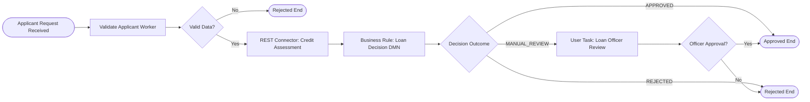

# Lab 1 Report: Loan Approval Workflow Automation

## 1. Executive Summary
This practical lab demonstrates an end-to-end automated loan assessment workflow using **Camunda 8 (Zeebe 8.6.8)**, **Spring Boot 3.3.5**, official Camunda 8 SDK `@JobWorker` annotations, an HTTP REST Connector, and a DMN decision table.

All applicant and financial data used throughout this lab is purely **synthetic**.

---

## 2. Architecture & Process Flow

---

## 3. Key Components
1. **Zeebe Job Worker**: `validate-applicant` implemented in `ApplicantValidationWorker.java`. Validates synthetic applicant details, age limits (>=18), requested loan bounds, and computes validation flags.
2. **REST Connector**: `io.camunda:http-json:1` invoking `http://localhost:8088/credit/assess`.
3. **DMN Decision Table**: `loan-decision` evaluates credit score, DTI ratio, and employment status with hit policy `FIRST`.
4. **User Task**: `loan-officers` candidate group with `camunda-forms:bpmn:manual-review.form`.
5. **Incident & Failure Injection**: Admin endpoint `POST /admin/failure-mode` triggers controlled 500 errors to verify Operate incident alerts and retry capabilities.

---

## 4. Test Execution & Verification Results
- **Automated Tests Executed**: 22/22 PASS (verified via `run-tests.ps1`)
- **Process Key**: `loan-approval-process`
- **Operate URL**: `http://localhost:8080/operate`
- **Tasklist URL**: `http://localhost:8080/tasklist`

