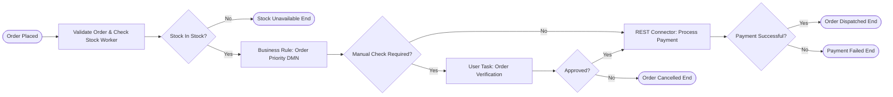

# Lab 2 Report: E-Commerce Order Processing Workflow

## 1. Executive Summary
This practical lab demonstrates an automated order fulfillment process using **Camunda 8 (Zeebe 8.6.8)**, **Spring Boot 3.3.5**, a custom inventory job worker (`@JobWorker`), an HTTP REST Connector for payment processing, and a DMN decision table for order prioritization.

All customer, product, and payment token data used is purely **synthetic**.

---

## 2. Architecture & Process Flow

---

## 3. Key Components
1. **Zeebe Job Worker**: `validate-order-and-check-stock` checks in-memory simulated warehouse inventory, calculates total cost, and flags stock availability.
2. **REST Connector**: `io.camunda:http-json:1` calling `http://localhost:8089/payments/charge`.
3. **DMN Decision Table**: `order-priority` assigns `HIGH`, `MEDIUM`, or `LOW` priority and determines if high-value review is needed.
4. **User Task**: `order-verifiers` candidate group with `manual-verification.form`.
5. **Incident & Failure Simulation**: Supports toggling failure mode via `POST /admin/failure-mode` on the payment mock service.

---

## 4. Test Execution & Verification Results
- **Automated Tests Executed**: 20/20 PASS (verified via `run-tests.ps1`)
- **Process Key**: `order-processing-process`
- **Operate URL**: `http://localhost:8080/operate`
- **Tasklist URL**: `http://localhost:8080/tasklist`

