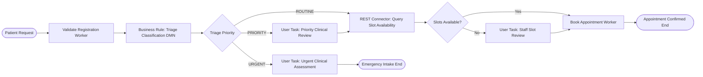

# Lab 3 Report: Hospital Emergency Triage & Appointment Scheduling

> **IMPORTANT DISCLAIMER**: This process and system is designed exclusively as an educational demonstration of Camunda 8 workflow orchestration. It does not provide medical diagnosis, clinical advice, or real healthcare triage.

## 1. Executive Summary
This practical lab demonstrates an automated healthcare triage and scheduling process using **Camunda 8 (Zeebe 8.6.8)**, **Spring Boot 3.3.5**, two external job workers (`validate-registration`, `book-appointment`), a REST Connector calling a slot-scheduling service, and a DMN decision table.

All patient identifiers, symptoms, and appointment details are **100% synthetic**.

---

## 2. Architecture & Process Flow

---

## 3. Key Components
1. **Zeebe Job Workers**:
   - `validate-registration`: In `RegistrationValidationWorker.java` (validates synthetic patient registration).
   - `book-appointment`: In `BookAppointmentWorker.java` (finalizes slot reservation and generates appointment tokens).
2. **REST Connector**: `io.camunda:http-json:1` invoking `GET http://localhost:8090/scheduling/slots?preference=...`.
3. **DMN Decision Table**: `triage-classification` categorizing urgency into `URGENT`, `PRIORITY`, or `ROUTINE`.
4. **User Tasks**: Handled by `triage-staff` candidate group for clinical and slot review.
5. **Incident & Failure Simulation**: Supports toggling failure mode via `POST /admin/failure-mode` on the scheduling mock service.

---

## 4. Test Execution & Verification Results
- **Automated Tests Executed**: 23/23 PASS (verified via `run-tests.ps1`)
- **Process Key**: `hospital-triage-process`
- **Operate URL**: `http://localhost:8080/operate`
- **Tasklist URL**: `http://localhost:8080/tasklist`

